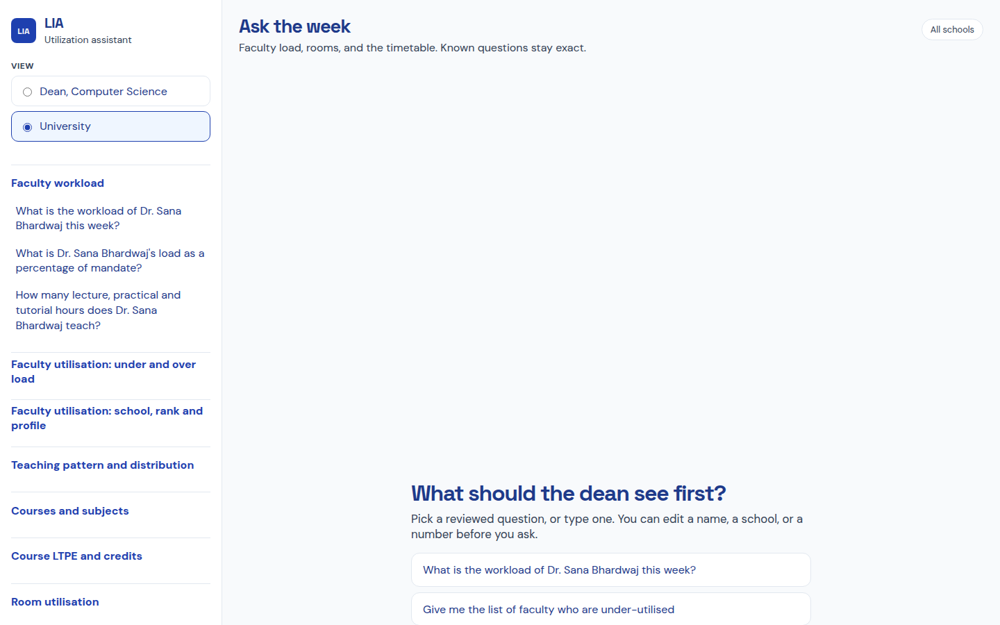
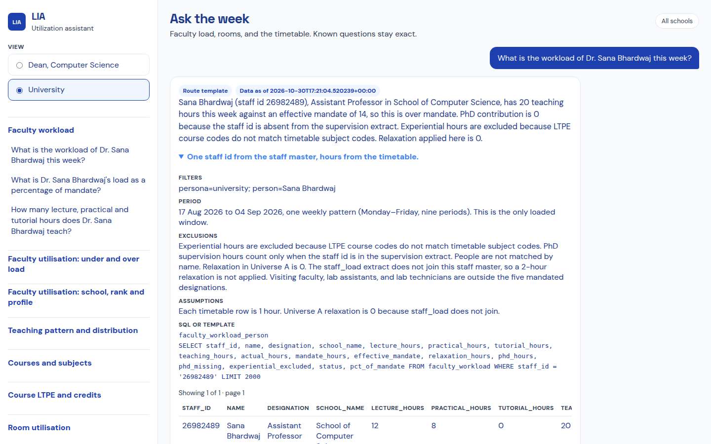
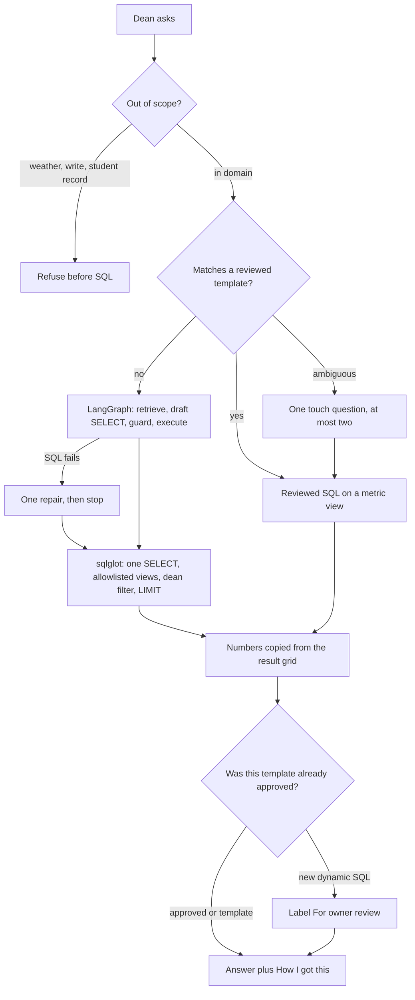
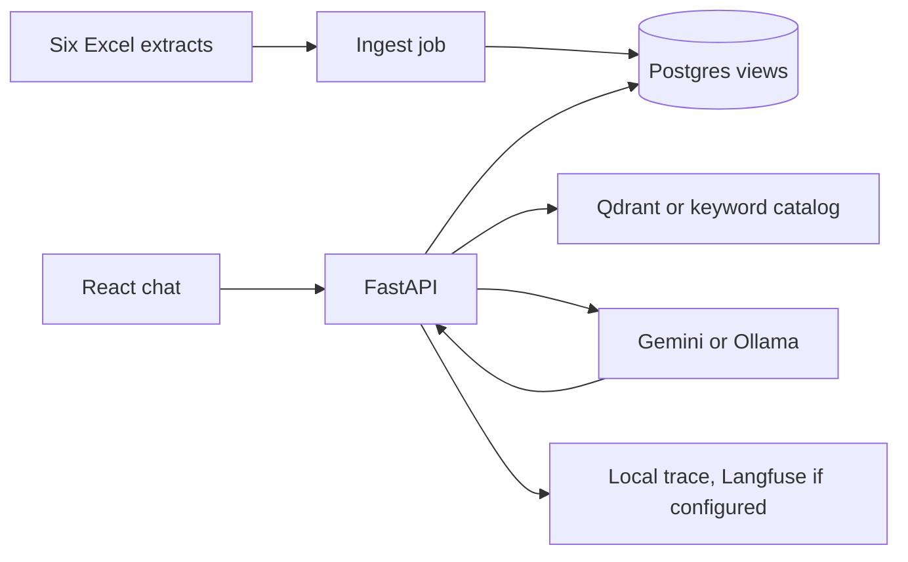
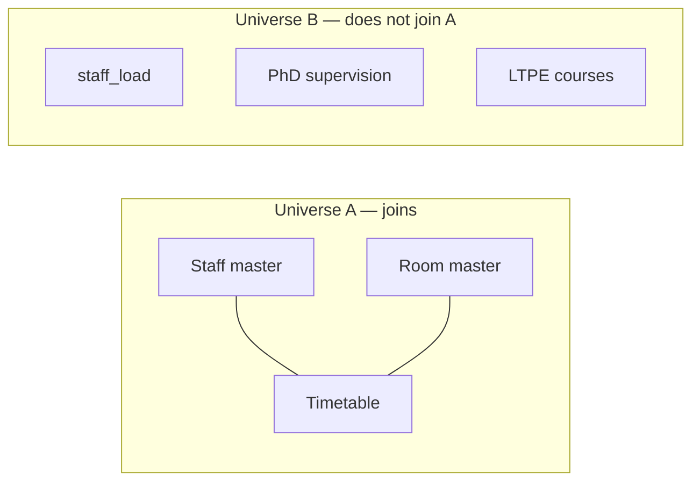
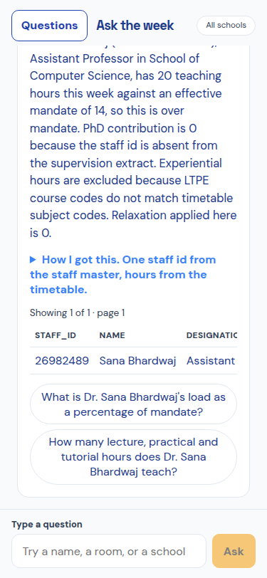
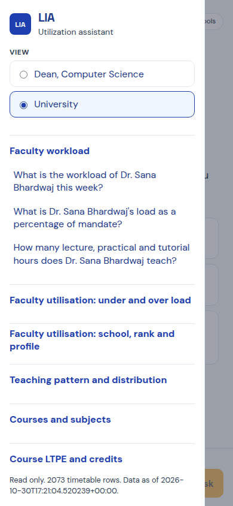
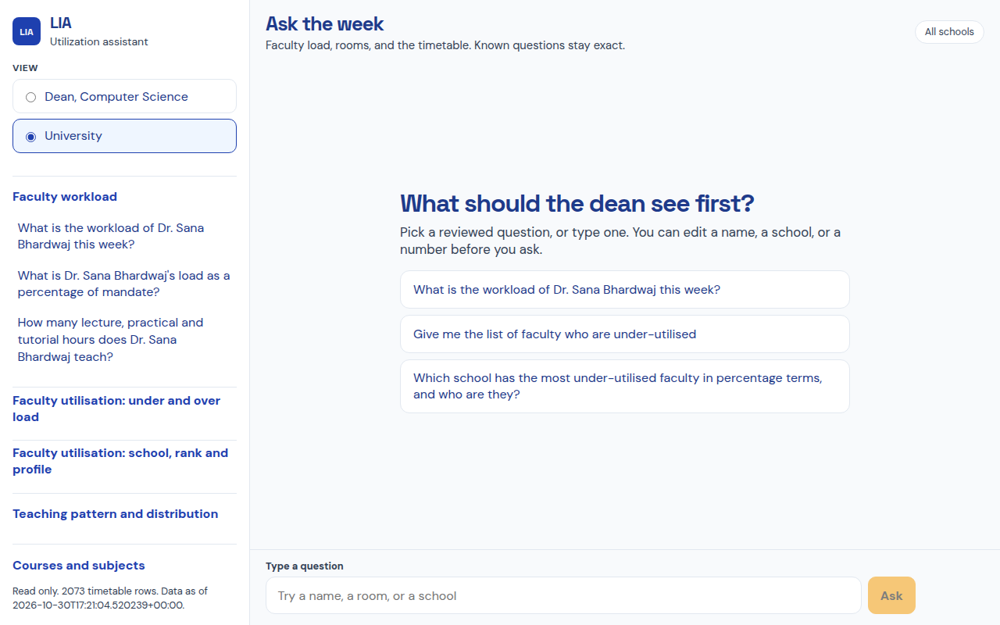

# LIA — Utilization Assistant

Read-only chat for a dean or a university administrator. It sits beside the utilization dashboard. The person asks about faculty workload, room use, or the weekly timetable and gets a number, a list, or one clarifying question. Known questions run as reviewed SQL. The model never writes those numbers.

**Live demo:** https://protest-earrings-colours-saskatchewan.trycloudflare.com

That address is a Cloudflare quick tunnel to the machine running this stack. It stays up while that process stays up. The reliable way to review the system is `docker compose up` below. The API health check on the demo returns the loaded timetable (`2073` rows).





## What a correct answer is

Sana Bhardwaj is staff id `26982489`, Assistant Professor, School of Computer Science.

| Rule | Value |
| --- | --- |
| Rank mandate | Dean 4, Professor 10, Associate Professor 12, Assistant Professor 14, teaching PhD scholar 8 |
| Her mandate | 14 |
| Relaxation | 0. She is not in the relaxation extract, so the 2-hour policy default is not applied |
| Timetable | 12 lecture + 8 practical + 0 tutorial = **20 hours** |
| PhD supervision | 0.25 hours per scholar, only when the staff id is in the supervision file. Hers is not |
| Experiential | Excluded. LTPE course codes do not match timetable subject codes |
| Result | **20 against 14, over mandate** |

Every answer has **How I got this**: filters, period, exclusions, assumptions, and the data-as-of time. The first line is visible. The rest opens on click.

## How a question is answered



Touch comes first. The left rail, and the **Questions** button on a phone, lists the 47 sample questions by area. Typing suggests matching templates. Editing the name, school, or number and then pressing Ask still runs reviewed SQL, because the slots are read from the text.

A dean of Computer Science sees only that school. The filter is injected after the SQL is parsed. The prompt is not the security boundary. A university user sees every school and is the only persona who can approve a new template.

## Why this shape

The chat turn is one HTTP request. The dean is waiting. A queue between the click and the SQL would add a poll loop and a failure the person can see.

| Decision | Choice | The option declined | Why |
| --- | --- | --- | --- |
| Request path | Synchronous API | Queue or pub/sub on the question | One person asked one question. A bus has nothing to fan out to. |
| Known questions | Hand-written SQL | Model-written SQL for the 47 samples | The brief requires those answers to be consistent and fast. Sana's hours must not change between two clicks. |
| Unknown questions | LangGraph, one repair | A single prompt that both writes SQL and states the total | The flow branches: clarify, draft, validate, execute, repair once, stop. The number has to come from Postgres. |
| Database | Postgres 16 | SQLite or DuckDB | The extracts came from Postgres. The read-only role and `statement_timeout` are the guardrails. |
| Metric layer | SQL views | Letting text-to-SQL redefine workload | Room Busy % is scheduled hours / 45. Seat occupancy and faculty-student ratio have a fixed grain. Both paths read the same views. |
| Join policy | Two universes, no name match | Fuzzy-join Sana to another Bhardwaj | Staff, rooms, and the timetable join on ids. `staff_load`, PhD supervision, and LTPE do not. A wrong join would publish a false load. |
| Vectors | Qdrant, behind one retriever | Putting the course catalog in the prompt | Retrieval is for columns, metric definitions, and example SQL. If Qdrant is down, the same documents are searched by keyword. |
| Models | Gemini if a key exists, else Ollama `llama3.2` | One provider | Routing and fallback are part of the evaluation. Templates still answer if both are down. |
| Email | Draft, then confirm, then SMTP | Sending when a period is missing | The brief forbids mail without confirmation. Missing SMTP returns a configuration error and does not open a socket. |
| UI | React, flat blue and amber | A dark admin console, or a children's type system | Deans scan a number, a table, and the rule. Phone and tablet use a question drawer. Laptop and TV keep the rail. |
| Runtime | Python, uv, FastAPI, Docker Compose | Microservices, Kubernetes | The consistency boundary is one ingest and one snapshot. Extra services would add failure modes before the 47 answers are right. |

Side work stays off the request: ingest runs before the API listens, traces are written after the answer is shaped, and email leaves only after confirm.



## Data, and what it refuses to pretend



| Fact | Grain |
| --- | --- |
| Teaching hour | One timetable row is one hour. A practical is already two consecutive rows, so it is two hours. |
| Room Busy % | Scheduled hours / 45. A week is 9 periods by 5 days. |
| Seat occupancy | Average of enrolment / seating capacity on that room's rows. |
| Faculty-student ratio | One enrolment per section, not the sum of every timetable row. Summing rows would count Computer Science as 42,440 instead of 6,366. A lecture section and its practical batch are different section ids, so a person can still be counted twice. The answer says so. |
| Under-utilised | Actual weekly hours below the effective mandate. Visiting faculty, lab assistants, and lab technicians are outside the five ranks. |
| SCSET | Alias of School of Computer Science in this mock. |
| History | One window only: 17 Aug 2026 to 4 Sep 2026. "Last week" and "last month" are offered as a labelled proxy. They are never relabelled as that period. |
| Inactive staff | The master has no active-status column. The answer says that, and does not invent a flag. |

There are no staff or room clashes in the mock. The clash queries still run and return zero.

## Scale, latency, throughput

100,000 users means 100,000 people with access, not 100,000 queries in flight. A busy morning is on the order of tens of questions a second, with a short burst above that.

The timetable is about 2,000 rows. Postgres is not the bottleneck. The model is.

| Path | What it does | Budget |
| --- | --- | --- |
| Template | Match, reviewed SQL, format | Under a few hundred milliseconds. No model call. |
| Dynamic | Retrieve, one SQL draft, guard, execute, at most one repair | Capped by the model. A failed SELECT does not become a made-up total. |

Throughput goes up by keeping common questions on the template path and adding API copies. A read replica and a cache keyed by persona, template, parameters, and data version come after a measured hot spot. The queue, if one is added later, sits in front of Ollama only. It does not sit in front of a reviewed question.

The definition of 14 hours does not change at 100 users or at 100,000.

## Screens

Below 1024px the question list is a drawer opened by **Questions**. The composer stays on screen. From 1024px up the list is a rail. At 1920px the shell stops stretching and stays centered. Tables scroll inside the answer. Page overflow was 0 at 375, 768, 1280, 1440, and 1920.







## Run

```bash
docker compose up -d --build
```

- Web: http://localhost:8090
- Health: http://localhost:8010/api/health

Host ports are 8010 and 8090 because 8000 and 8080 were already taken on the build machine.

Ollama is optional. Templates do not need it.

```bash
docker compose --profile ollama up -d
docker exec lia-ollama-1 ollama pull llama3.2
```

The model stays in the `lia-ollama` volume. The API calls it at `http://ollama:11434`.

Reload the Excel files. A second run does not duplicate rows.

```bash
docker compose exec -T api python -m app.ingest
```

Tests, from `apps/api`:

```bash
uv sync --group dev
uv run pytest
```

Copy `.env.example`. Do not commit real keys.

| Variable | Role |
| --- | --- |
| `GOOGLE_API_KEY` or `GEMINI_API_KEY` | Gemini for unmatched questions |
| `GEMINI_MODEL` | Defaults to `gemini-2.5-flash` |
| `OLLAMA_BASE_URL` | Used when that URL answers `/api/tags` |
| `OLLAMA_MODEL` | Defaults to `llama3.2` |
| `LANGFUSE_PUBLIC_KEY`, `LANGFUSE_SECRET_KEY`, `LANGFUSE_HOST` | Optional trace export |
| `SMTP_HOST`, `SMTP_PORT`, `SMTP_USER`, `SMTP_PASSWORD`, `SMTP_FROM`, `DATA_OWNER_EMAIL` | Real SMTP, only after confirm |
| `DATABASE_URL`, `READONLY_DATABASE_URL` | Admin and read-only roles |
| `QDRANT_URL` | Schema and metric retrieval |
| `DATA_DIR` | Excel folder |
| `TRACE_DIR` | Local JSONL traces |

## What to click in a review

1. **What is the workload of Dr. Sana Bhardwaj this week?** Expect 20 against 14, PhD missing, experiential excluded.
2. **Give me the list of faculty who are under-utilised.** Expect a count and a page of 20, with Next page.
3. **Show occupancy.** Expect room versus faculty, then busy percent versus seat occupancy.
4. **Show occupancy for last month.** Expect the same choice, plus the statement that the earlier period is not loaded.
5. Switch to **Dean, Computer Science** and ask for under-utilised faculty. Expect only that school.
6. **What is the weather in Delhi?** Expect a refusal and no SQL.
7. **Move Sana's class to Tuesday.** Expect a refusal. LIA does not write.
8. Type a question that is not in the list. Expect either a labelled dynamic answer with **Approve as a template**, or a clear "no model" message if neither Gemini nor Ollama is up. Approving makes the next identical question skip the model.

`evidence/e2e-results.md` records the earlier live checks.

## What this prototype does not claim

- It does not edit CAMU or the timetable.
- It does not send email unless SMTP is configured and the user confirms.
- It does not invent last month, an active-status flag, or a supervision row for a person who is not in that extract.
- The quick-tunnel URL is for a live look. It is not the production deploy.
